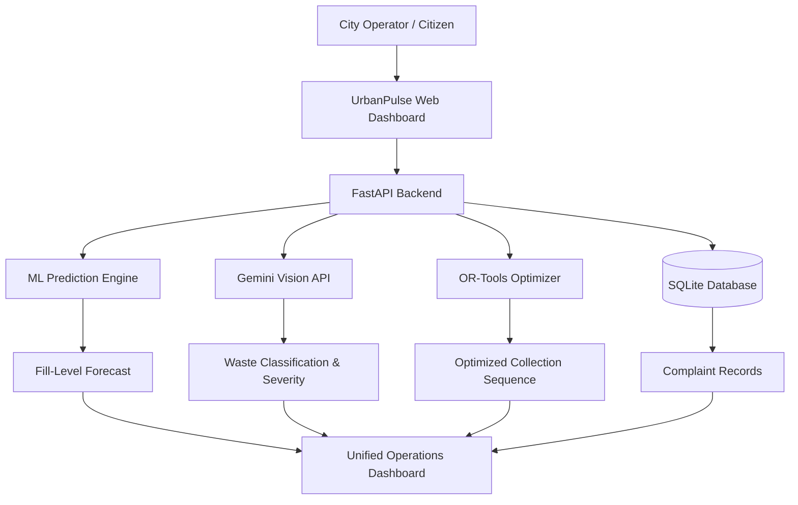
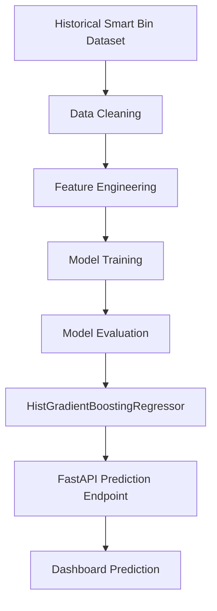
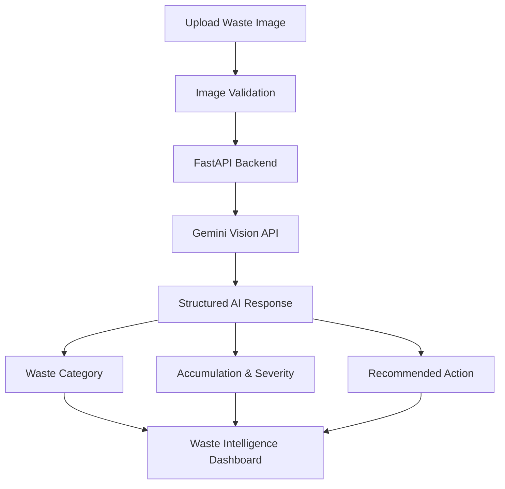
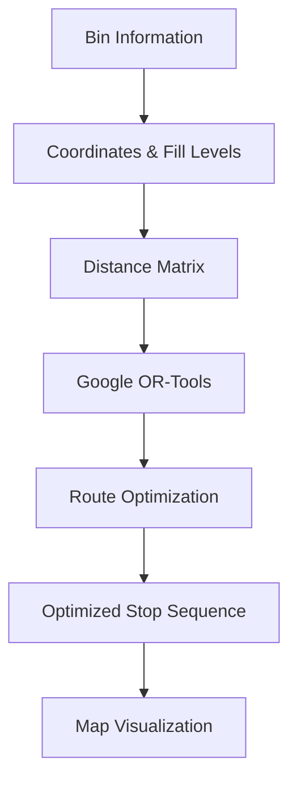

# 🌆 UrbanPulse AI
### Intelligent Waste Management & Smart City Operations Platform

**Transforming waste management through Machine Learning, Computer Vision and Route Optimization.**

UrbanPulse AI is an AI-powered smart city waste management platform designed to help city operators monitor waste levels, analyze garbage images, optimize waste collection routes and manage citizen complaints through a unified dashboard.

It combines predictive machine learning, Gemini Vision AI and mathematical optimization to support smarter and more efficient urban waste management.

---

## ⚡ Understand UrbanPulse AI in 60 Seconds

| Problem | UrbanPulse AI Solution |
|---|---|
| Waste bins fill up unpredictably | ML-based fill-level forecasting |
| Garbage accumulation is difficult to assess | Gemini Vision image analysis |
| Collection routes may be inefficient | OR-Tools route optimization |
| Citizen complaints are difficult to track | Digital complaint management |
| City operations are spread across different systems | Unified smart city dashboard |

**In simple words:** UrbanPulse AI helps predict, analyze, prioritize and organize waste management operations from one platform.

---

## 🚀 Key Features

### 1. 🤖 Smart Bin Prediction
- Predicts upcoming bin fill levels using historical waste data.
- Uses a trained HistGradientBoostingRegressor model.
- Builds time-series features using lag values and rolling averages.
- Displays prediction results and historical trends.

### 2. 📸 AI-Powered Waste Intelligence
- Upload garbage images for AI-powered analysis.
- Uses Google Gemini Vision API.
- Identifies waste categories such as plastic, paper, metal and organic waste.
- Estimates accumulation and overflow severity.
- Provides recommended actions and uncertainty information.

### 3. 🗺️ Smart Collection Route Optimization
- Uses Google OR-Tools to optimize collection order.
- Considers bin coordinates, fill levels and priorities.
- Calculates approximate travel distance using geographic coordinates.
- Displays optimized collection routes on the dashboard map.

### 4. 🏙️ Citizen Complaint Management
- Register waste-related complaints.
- Store complaint information using SQLite.
- Generate complaint IDs.
- Track complaint status.
- Provide an administrative interface for complaint management.

### 5. 📊 Unified Analytics Dashboard
- Smart city overview.
- Bin monitoring.
- Collection route management.
- Waste intelligence.
- Citizen complaints.
- Analytics and map visualization.

---

## 🧠 System Architecture



### AI/ML Workflow



### Waste Image Analysis Workflow



### Smart Collection Route Workflow



---

## 🛠️ Technology Stack

| Layer | Technologies |
|---|---|
| Frontend | HTML5, CSS3, JavaScript |
| Backend | Python, FastAPI |
| Machine Learning | Scikit-learn, Pandas, NumPy |
| Computer Vision | Google Gemini Vision API |
| Optimization | Google OR-Tools |
| Database | SQLite |
| Maps | Leaflet.js, OpenStreetMap |
| Testing | Pytest, JavaScript tests |
| Version Control | Git, GitHub |

---

## 📈 Machine Learning Model

The Smart Bin Prediction module uses historical fill-level observations to forecast the next fill-level value.

**Dataset information:**

- 659 unique historical observations.
- Historical period: June 2018 – June 2020.
- Target variable: `latestFullness`.
- Time-series feature engineering.

**Champion Model:** HistGradientBoostingRegressor

**Features used:**
- Lag 1, 2, 3 and 7.
- Rolling mean 3 and 7.
- Day of week.
- Month.

**Reported evaluation:**

| Metric | Result |
|---|---:|
| MAE | 1.3166 |
| RMSE | 1.6212 |
| R² | 0.4878 |

The model output is on the dataset's original 0–10 scale.

These results represent historical test-set performance, not guaranteed real-world performance.

---

## 📁 Project Structure

```text
UrbanPulse-AI/
│
├── backend/
│   ├── api/
│   │   ├── routes_complaints.py
│   │   ├── routes_optimization.py
│   │   └── routes_waste.py
│   │
│   ├── database/
│   │   └── complaint_repository.py
│   │
│   ├── schemas/
│   ├── services/
│   └── main.py
│
├── frontend/
│   ├── assets/
│   │   ├── css/
│   │   └── js/
│   ├── home.html
│   └── index.html
│
├── ml/
│   ├── models/
│   ├── notebooks/
│   ├── src/
│   └── evaluation/
│
├── datasets/
│   └── processed/
│
├── tests/
│
├── docs/
│
├── .env.example
├── .gitignore
└── requirements.txt
```

---

## ⚙️ Run Locally

### Prerequisites

- Python 3.11
- Git
- Google Gemini API key

### 1. Clone the repository

```bash
git clone https://github.com/shivamdwivedicse/UrbanPulse-AI.git

cd UrbanPulse-AI
```

### 2. Create a virtual environment

Windows PowerShell:

```powershell
python -m venv .venv

.\.venv\Scripts\Activate.ps1
```

### 3. Install dependencies

```bash
python -m pip install --upgrade pip

pip install -r requirements.txt
```

### 4. Configure environment variables

```powershell
Copy-Item .env.example .env
```

Add your Gemini API key inside `.env`:

```env
GEMINI_API_KEY=your_gemini_api_key
```

Never commit your actual `.env` file or API key.

### 5. Start the application

```bash
python -m uvicorn backend.main:app --reload
```

### 6. Open UrbanPulse AI

| Resource | Local URL |
|---|---|
| Application | http://127.0.0.1:8000/ |
| Dashboard | http://127.0.0.1:8000/dashboard |
| API Documentation | http://127.0.0.1:8000/docs |
| Health Check | http://127.0.0.1:8000/health |

---

## 🧪 Testing

Run the automated Python test suite:

```bash
python -m pytest -q
```

The project has successfully passed **62 automated Python tests** in the current development environment.

---

## 🌍 Deployment

UrbanPulse AI is designed as a FastAPI application serving its frontend and backend from one application.

Recommended hosting: Render Web Service.

Deployment configuration:

```text
Build Command:
pip install -r requirements.txt

Start Command:
uvicorn backend.main:app --host 0.0.0.0 --port $PORT
```

Configure `GEMINI_API_KEY` in the hosting provider's environment variables.

Persistent storage must be configured for SQLite complaint records and uploaded files if they need to survive restarts and redeployments.

---

## ⚠️ Important Project Scope & Limitations

UrbanPulse AI is currently a working prototype and decision-support platform.

- The historical Smart Bin dataset represents one prototype bin.
- The historical dataset covers 2018–2020; predictions should not be interpreted as live IoT measurements.
- Sample map coordinates are illustrative, not verified operational city-bin locations.
- Route distances are geographic straight-line approximations, not road-navigation distances.
- Gemini Vision analysis depends on external API availability and may temporarily be unavailable due to provider rate limits.
- SQLite is currently used for complaint persistence; production deployment requires durable storage.
- No real-time IoT hardware integration is currently claimed.

These limitations are documented to distinguish demonstrated functionality from future deployment capabilities.

---

## 🔮 Future Enhancements

- Real-time IoT smart-bin integration.
- Live GPS-based collection tracking.
- Road-network-aware route optimization.
- Production-grade database and authentication.
- Multi-city deployment.
- Predictive waste generation analytics.
- Automated collection scheduling.
- Advanced city-level sustainability insights.

---

## 👨‍💻 Project Author

**Shivam Dwivedi**

B.Tech Computer Science & Engineering

Interests: Artificial Intelligence, Machine Learning, Data Science and Smart City Technologies.

GitHub: shivamdwivedicse

---

## ⭐ Support

If you find this project interesting, consider giving this repository a star.

**UrbanPulse AI — Building cleaner, smarter and more sustainable cities through AI.**